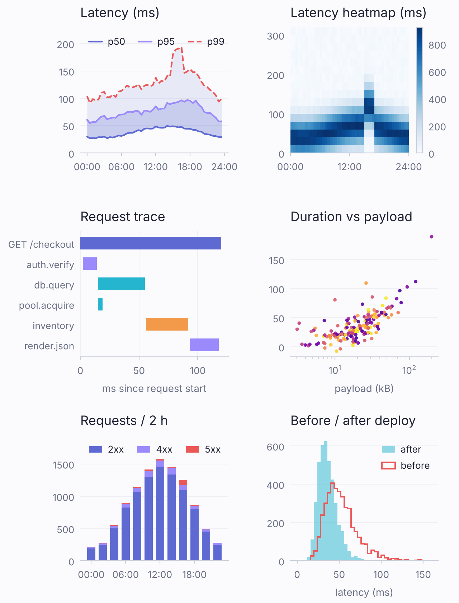
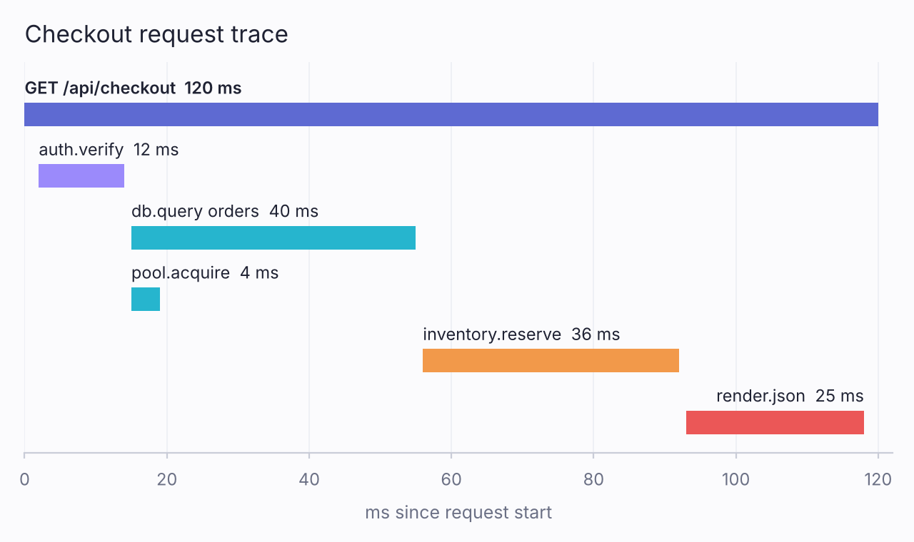
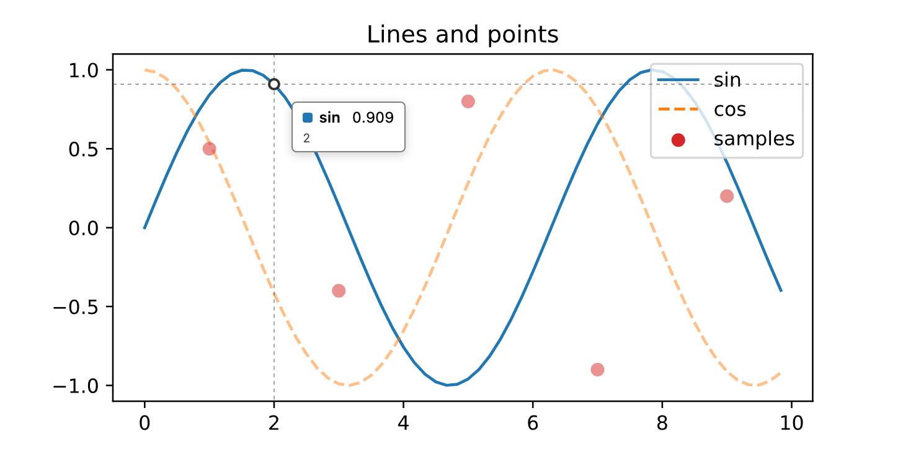

# mpljs

**matplotlib's pixels, in pure JavaScript.** A zero-dependency reimplementation of matplotlib 3.11.2's
rendering — its layout, tickers, text and its Agg rasterizer — that runs in Node, browsers and Cloudflare Workers.

[](https://github.com/ivarvong/mpl/actions/workflows/ci.yml)
[](LICENSE)
[](package.json)

<p align="center">
  <picture>
    <source media="(prefers-color-scheme: dark)" srcset="docs/images/readme/hero-dark.png">
    <source media="(prefers-color-scheme: light)" srcset="docs/images/readme/hero-light.png">
    
  </picture>
</p>
<p align="center"><sub>One mpljs figure, six Axes (<a href="scripts/readme_images.ts"><code>scripts/readme_images.ts</code></a>), in the bundled <code>pro-slate</code> and <code>pro-dark</code> themes.</sub></p>

## Same code, same pixels

**matplotlib 3.11.2**, Python:

<picture>
  <source media="(prefers-color-scheme: dark)" srcset="fixtures/ref/example_trace_pro_dark.png">
  <source media="(prefers-color-scheme: light)" srcset="fixtures/ref/example_trace_pro_slate.png">
  
</picture>

**mpljs**, TypeScript:

<picture>
  <source media="(prefers-color-scheme: dark)" srcset="docs/images/readme/trace-pro-dark.png">
  <source media="(prefers-color-scheme: light)" srcset="docs/images/readme/trace-pro-slate.png">
  
</picture>

All 651,200 pixels are identical, in both themes. The first image is matplotlib's own `savefig` output, committed
as an oracle fixture ([`fixtures/ref/example_trace_pro_slate.png`](fixtures/ref/example_trace_pro_slate.png),
[`…_pro_dark.png`](fixtures/ref/example_trace_pro_dark.png)). The second is
[`examples/trace.ts`](examples/trace.ts), and [`test/examples.test.ts`](test/examples.test.ts) checks it against
matplotlib's on every CI run. Both are 200 dpi, so the comparison is at the resolution shown. The `pro-slate` and
`pro-dark` themes are plain `.mplstyle` files in [`styles/`](styles/), so matplotlib reads them unchanged.

The Python below, run with matplotlib 3.11.2 on Linux x86-64, writes the first PNG byte for byte:

```python
import matplotlib.pyplot as plt

plt.style.use("styles/pro-slate.mplstyle")   # ships with mpljs; matplotlib reads it as is
plt.rcParams.update({"figure.figsize": (4.4, 3.7), "figure.dpi": 200,
                     "text.hinting": "none"})   # mpljs draws unhinted text

spans = [
    ("GET /api/checkout", 0, 120, "C0"),
    ("auth.verify", 2, 14, "C1"),
    ("db.query orders", 15, 55, "C2"),
    ("pool.acquire", 15, 19, "C2"),
    ("inventory.reserve", 56, 92, "C4"),
    ("render.json", 93, 118, "C3"),
]
names, starts, ends, colors = zip(*spans)

fig, ax = plt.subplots()
ax.barh(range(len(spans)), [e - s for s, e in zip(starts, ends)],
        left=starts, color=colors, height=0.34)
for i, (name, s, e, _) in enumerate(spans):
    late = s > 80   # near the right edge: end the label at the bar's end
    ax.text(e if late else s, i - 0.25, f"{name}  {e - s} ms",
            ha="right" if late else "left", va="bottom", fontsize=9.5,
            fontweight="semibold" if i == 0 else "normal")
ax.set_yticks([])
ax.set_ylim(len(spans) - 0.5, -0.85)
ax.set_xlim(0, 122)
ax.grid(False, axis="y")
ax.grid(True, axis="x")
ax.set_xlabel("ms since request start")
ax.set_title("Checkout request trace")
fig.tight_layout()
fig.savefig("trace.png")
```

The mpljs version is the same calls. mpljs always draws text unhinted, so it has no `text.hinting` key:

```ts
import { registerFonts, subplots } from 'mpl';
import { interRegular } from 'mpl/fonts/inter-regular';
import { interSemibold } from 'mpl/fonts/inter-semibold';
registerFonts(interRegular, interSemibold);   // faces are opt-in modules

const spans = [
  ['GET /api/checkout', 0, 120, 'C0'],
  ['auth.verify', 2, 14, 'C1'],
  ['db.query orders', 15, 55, 'C2'],
  ['pool.acquire', 15, 19, 'C2'],
  ['inventory.reserve', 56, 92, 'C4'],
  ['render.json', 93, 118, 'C3'],
] as const;

const [fig, ax] = subplots({
  style: 'pro-slate',
  rc: { 'figure.figsize': [4.4, 3.7], 'figure.dpi': 200 },
});
ax.barh(spans.map((_, i) => i), spans.map(([, s, e]) => e - s), {
  left: spans.map(([, s]) => s),
  color: spans.map(([, , , c]) => c),
  height: 0.34,
});
spans.forEach(([name, s, e], i) => {
  const late = s > 80;   // near the right edge: end the label at the bar's end
  ax.text(late ? e : s, i - 0.25, `${name}  ${e - s} ms`, {
    ha: late ? 'right' : 'left', va: 'bottom', fontsize: 9.5,
    fontweight: i === 0 ? 'semibold' : 'normal',
  });
});
ax.set_yticks([]);
ax.set_ylim(spans.length - 0.5, -0.85);
ax.set_xlim(0, 122);
ax.grid(false, { axis: 'y' });
ax.grid(true, { axis: 'x' });
ax.set_xlabel('ms since request start');
ax.set_title('Checkout request trace');
fig.tight_layout();
const png = fig.toPNGSync();
```

That is the rule for the whole library, not one demo: `node test/compare.ts` replays every fixture matplotlib
generated and compares the decoded pixels — **376 of 376 pixel-exact** at the time of writing — plus tick, label and
legend-extent records, and seeded fuzzers against matplotlib's tickers (106,000 cases) and date locators (12,000).
Details: [docs/internals.md](docs/internals.md#verification).

## Quickstart

mpljs installs from GitHub (it is not on the npm registry) and needs Node 24+ to build.

```sh
npm install github:ivarvong/mpl
```

**Node** — write a PNG and an SVG:

```ts
import { writeFileSync } from 'node:fs';
import { subplots } from 'mpl';

const x = Array.from({ length: 200 }, (_, i) => i / 16);
const [fig, ax] = subplots();
ax.plot(x, x.map(Math.sin), { label: 'sin(x)' });
ax.plot(x, x.map(Math.cos), '--', { label: 'cos(x)' });
ax.legend();
writeFileSync('chart.png', fig.toPNGSync({ scale: 2 }));
writeFileSync('chart.svg', fig.toSVG());
```

**Cloudflare Worker** — the same library, no native modules, no canvas; the PNG streams as it encodes:

```ts
import { subplots } from 'mpl';

export default {
  fetch(): Response {
    const [fig, ax] = subplots();
    ax.bar(['api', 'web', 'worker'], [120, 85, 42]);
    return new Response(fig.pngStream({ scale: 2 }), {
      headers: { 'content-type': 'image/png' },
    });
  },
};
```

Browsers take the same import through any bundler. To try it in the repo: `git clone`, `npm ci`, `npm run example`.

## What's in it

- **Plots:** line, step, scatter, bar and barh, hist, errorbar, boxplot, fill_between, imshow with colorbar,
  reference lines and spans, text and annotate.
- **Axes:** linear, log and date scales (matplotlib's date locators and formatters), categories, twinx, inverted
  and shared axes, aspect.
- **Layout:** subplot grids with shared axes and width/height ratios, tight_layout, subplots_adjust, figure
  titles and labels, legends including `loc='best'`.
- **Style:** matplotlib's bundled `.mplstyle` sheets, four dashboard themes (`pro-dark`, `pro-mono`, `pro-ember`,
  `pro-slate`, each pixel-exact against matplotlib), rc overrides. Fonts: DejaVu Sans/Serif and Inter.
- **Colormaps:** viridis, plasma, inferno, magma, cividis, twilight, turbo, coolwarm, RdBu, Greys, Blues, tab10,
  tab20 and their `_r`.
- **Output:** PNG from mpljs's own Agg port (any dpi, `scale: 2` for retina, palette PNGs); SVG with `<text>` or glyph
  outlines (`svg.fonttype: 'path'`), optional coordinate rounding; string, chunk or `ReadableStream`; raw RGBA; a
  JSON scene tree.
- **Large data:** matplotlib's own path simplification (a 1,000,000-point sine becomes the same 142 vertices
  matplotlib draws) and opt-in min/max decimation per pixel column.
- **Tracing:** OpenTelemetry-shaped spans per layout stage, artist and text layout; a shared no-op when disabled.

Unknown keyword arguments throw, as in matplotlib. Not yet: `violinplot`, `pie`, `stem`, `stairs`,
`subplot_mosaic`, general mathtext, constrained layout ([full list](docs/guide.md#api-overview)).

## Interactive SVG

`fig.toSVG({ interactive: true })` draws the same SVG plus a small JSON sidecar of each artist's data. The
`mpl/interactive` client (6.2 KiB gzipped, no dependencies) turns it into a crosshair, a nearest-point tooltip,
series highlighting, legend toggles and arrow-key navigation, with no re-render. `mpl/zoom` (10.5 KiB gzipped with
the client) adds wheel, drag, box, pinch and keyboard zoom and pan, where every frame is a real mpljs render loaded on
the first gesture ([guide](docs/guide.md#zoom-and-pan-mplzoom)).

<p align="center">
  
</p>

## Runtimes, size, speed

- **Tested in** Node 24, headless Chromium (non-UTC time zone, non-English locale) and workerd. CI checks that SVG
  and PNG output in each is byte-identical to Node's and pixel-exact against matplotlib.
- **Bundle,** minified + gzipped (`npm run size`): 179 KiB for the default entry with DejaVu Sans built in;
  116 KiB for `mpl/core` before any font, then 16–17 KiB per Inter weight. `npm run test:size` holds a +2% budget.
- **Re-render:** panning a chart and re-rendering it as SVG, DOM update included, took 0.5–1.4 ms per frame (p50)
  for ordinary charts in Chrome on an Apple M3 Max.
- **Live:** [mpl.ivar.workers.dev](https://mpl.ivar.workers.dev) is a Cloudflare Worker that renders a chart whose
  entire spec is in the URL, as PNG, SVG or an interactive page.

## Documentation

- [docs/guide.md](docs/guide.md) — install, fonts, lean loading for Workers, examples, themes, colormaps,
  interactive SVG, tracing, runtimes.
- [docs/api.md](docs/api.md) — every `Figure` and `Axes` method and keyword, generated from `src/api.ts`.
- [docs/internals.md](docs/internals.md) — verification, architecture and modeling rules, performance, regenerating
  the oracle.
- [CONTRIBUTING.md](CONTRIBUTING.md) · [SECURITY.md](SECURITY.md)

## License

ISC, see [LICENSE](LICENSE). Bundled fonts, matplotlib-derived tables and ported algorithms are covered by
[THIRD_PARTY_NOTICES.md](THIRD_PARTY_NOTICES.md).
