# mpljs guide

How to install mpljs, load fonts and colormaps, and use each part of the API, with runnable examples. The full
reference, generated from `src/api.ts` and checked by a test, is [api.md](api.md). How the library is built and
verified is in [internals.md](internals.md).

- [Installing](#installing)
- [Fonts](#fonts-you-pay-only-for-the-faces-you-render)
- [Lean loading (Workers)](#lean-loading-workers)
- [Examples](#examples)
- [API overview](#api-overview)
- [PNG output: palette and compression](#png-output-palette-and-compression)
- [Colormaps and images](#colormaps-and-images)
- [Themes](#themes)
- [Style sheets and rc](#style-sheets-and-rc)
- [Interactive SVG (annotated)](#interactive-svg-annotated)
- [Zoom and pan (mpl/zoom)](#zoom-and-pan-mplzoom)
- [Tracing](#tracing)
- [Runtimes and bundle size](#runtimes-and-bundle-size)

## Installing

mpljs is distributed from GitHub (it is not on the npm registry). The package entry point is the built
`dist/browser/` (plain ES modules plus `.d.ts` types), made by `npm run build`. It is not committed; npm builds it
for you through the `prepare` script.

From GitHub (npm clones the repo, installs the dev dependencies, runs `prepare`, then packs `dist/`):

```sh
npm install github:ivarvong/mpl          # or pin: github:ivarvong/mpl#<commit-sha>
```

From a local checkout (a symlink; rebuild after pulling):

```sh
git clone https://github.com/ivarvong/mpl.git && (cd mpl && npm ci)   # npm ci runs prepare → dist/
cd your-project && npm install ../mpl                                 # "mpl": "file:../mpl"
```

Then, in an ES module (Node 24+, browsers, Workers):

```ts
import { subplots } from 'mpl';

const [fig, ax] = subplots();
ax.barh([0, 1, 2], [3, 2, 4], { left: [0, 3, 5] });
fig.tight_layout();
const svg = fig.toSVG(), png = fig.toPNGSync();
```

Inside this repository, import from `./src/index.ts`: Node runs the TypeScript directly (it strips the types). Node
refuses to strip types inside `node_modules`, which is why the package ships `dist/browser`.

```sh
git clone https://github.com/ivarvong/mpl.git && cd mpl
npm ci
npm run example        # writes examples/out/quickstart.svg and .png
```

## Fonts: you pay only for the faces you render

Each font face is its own module. The default `mpl` entry registers DejaVu Sans (matplotlib's default), so a
quickstart needs no `registerFonts` call. Other faces you import and register before rendering:

```ts
import { registerFonts, subplots } from 'mpl';
import { dejavuSansBold } from 'mpl/fonts/dejavu-sans-bold';

registerFonts(dejavuSansBold);
const [fig, ax] = subplots();
ax.set_title('Checkout latency', { fontweight: 'bold' });
```

| to render | register |
|---|---|
| default rc: anything in `sans-serif` at normal weight | nothing on the main entry (DejaVu Sans is built in) |
| bold text (`fontweight: 'bold'`, bold tick labels or titles) | `dejavuSansBold` |
| `font.family: 'serif'`, the `paperClassic` preset | `dejavuSerif` (+ `dejavuSerifBold` for bold) |
| the `paperModern` preset | `interRegular` |
| the `modern` and `modernDark` presets | `interRegular`, `interSemibold` |
| everything, when size does not matter | `import { allFonts } from 'mpl/fonts/all'`, then `registerFonts(...allFonts)` |
| Workers / lean bundles — pay only for what you use | import from [`mpl/core`](#lean-loading-workers) and register every face |

Font selection works as in matplotlib, over every face mpl ships. Registering a face never changes which face
a text gets. If the selected face is not registered, rendering throws a `FontNotLoadedError` that names the import
to add. It never draws a different face instead. The face table and details are in [api.md](api.md#fonts).

Text uses DejaVu Sans/Serif or Inter (`scripts/gen_fonts.py` bakes them).
- DejaVu carries ASCII plus Latin-1, Latin Extended-A, Greek letters, general punctuation, super/subscripts, currency,
  arrows, math operators, box drawing, block elements, geometric shapes and ✓/✗.
- Inter carries ASCII and a few Latin-1 signs (− × µ ² ³ √ ° ± ·), plus General Punctuation, Arrows, Geometric
  Shapes and the check marks, as far as Inter v4.0 maps them (■ ● ‒ ▲ ✓ …). Each further block costs every Inter
  module its outlines and kerning: Latin-1 letters alone would add 50 KB per face.
- Font fallback works as in matplotlib 3.11: each `font.family` entry resolves to one font (`'sans-serif'` to the first
  `font.sans-serif` name shipped), and a character the first font lacks comes from the next entry that has it.
  libraqm shapes each face's run on its own (fixtures `font_fallback_chain*`). With `font.family: ['Inter', 'DejaVu
  Sans']`, ∀ ∈ ∇ ⇄ draw from DejaVu.
- Not matched, by design:
  - matplotlib ends every chain with LastResort, a box-per-Unicode-block font mpl doesn't ship, so a character no
    listed font has draws the first font's .notdef box.
  - Characters Inter has but mpl doesn't bake (accented letters, Greek, math operators, box drawing) fall back along
    `font.family`, where matplotlib would draw Inter's own.
- Missing glyphs warn once: `Glyph N (c) missing from font(s) …` when the font lacks it (as matplotlib does), or
  `… is in Inter but not bundled with mpl` when only the baked subset lacks it.

## Lean loading (Workers)

The main entry keeps matplotlib's defaults so existing apps need no register calls. For a Cloudflare Worker
(or any bundle that should pay only for the faces and colormaps a chart uses), import the lean entry and
register explicitly. Nothing is side-registered; an unregistered face or colormap throws
`FontNotLoadedError` / `ColormapNotLoadedError` — never a silent fallback:

```ts
import { registerColormapRgba, registerColormaps, registerFonts, subplots } from 'mpl/core';
import { interRegular, interMedium, interSemibold, interBold } from 'mpl/fonts/all';
import { magma } from 'mpl/colormaps/magma';
import { magma_rgba } from 'mpl/colormaps/magma.rgba';
import { viridis } from 'mpl/colormaps/viridis';
import { viridis_rgba } from 'mpl/colormaps/viridis.rgba';

registerFonts(interRegular, interMedium, interSemibold, interBold);
registerColormaps(magma, viridis);
registerColormapRgba(magma_rgba, viridis_rgba);
```

`import { allFonts } from 'mpl/fonts/all'` and `allColormaps` / `allColormapRgba` still register everything when
size does not matter. Package export: `mpl/core`.

## Examples

Runnable examples are in [`examples/`](../examples) (`npm run examples` runs them all): lines, categorical bars, a
log axis, dates, `twinx` with a theme, a Gantt chart, small multiples, histograms with error bars, a value-coloured
scatter, `imshow` with a colorbar, the pro-theme dashboards and an interactive page. Each writes SVG and PNG into the
gitignored `examples/out/`. `test/examples.test.ts` checks that every picture on this page is byte-for-byte what its
example produces today, and the oracle cases among them pixel for pixel against matplotlib.

### Quickstart

```ts
import { subplots } from '../src/index.ts';

const x = Array.from({ length: 200 }, (_, i) => (i / 199) * 4 * Math.PI);
const [fig, ax] = subplots();
ax.plot(x, x.map(Math.sin), { label: 'sin(x)' });
ax.plot(x, x.map(Math.cos), '--', { label: 'cos(x)' });
ax.legend();
fig.toSVG();  fig.toPNGSync();   // a string, and a Uint8Array of PNG bytes
```

<p>
  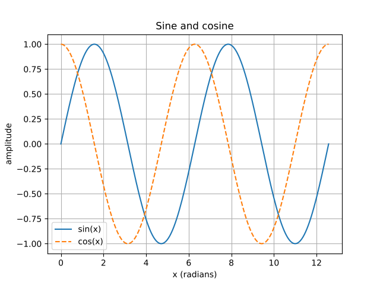
  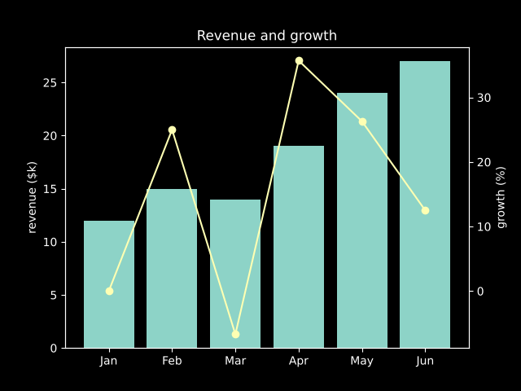
</p>

### A request-trace waterfall

[`examples/trace.ts`](../examples/trace.ts) draws a request trace with `barh(..., { left })`, writes each span's name
and duration above its bar with `ax.text` (no tick labels; the root in semibold), keeps only an x grid
(`ax.grid(false, { axis: 'y' })`, then `ax.grid(true, { axis: 'x' })`), and renders at 200 dpi in the `pro-slate` and
`pro-dark` sheets. The same calls are oracle cases (`fixtures/ref/example_trace_pro_{slate,dark}`) that match
matplotlib pixel for pixel:

<picture>
  <source media="(prefers-color-scheme: dark)" srcset="images/readme/trace-pro-dark.png">
  <source media="(prefers-color-scheme: light)" srcset="images/readme/trace-pro-slate.png">
  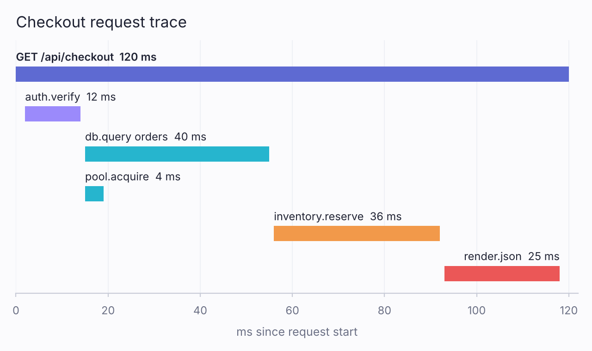
</picture>

[`examples/gantt.ts`](../examples/gantt.ts) is the same trace in matplotlib's default style, with tick labels
(`set_yticklabels`, a bold root via `ax.get_yticklabels()[0].set_fontweight('bold')`) and box-drawing characters; it is
also an oracle case (`fixtures/ref/example_gantt_trace`).

### Subplot grids (small multiples)

`subplots(nrows, ncols, { sharex, sharey, gridspec_kw })` returns matplotlib's shapes, typed. A 1x1 grid with squeeze gives one
`Axes`, a single row or column gives `Axes[]`, and anything else gives rows of Axes (`Axes[][]`). Shared axes get one set of
limits and ticks, and keep tick labels on the outer panels only:

```ts
const [fig, axes] = subplots(2, 3, { sharex: true, sharey: true, figsize: [9, 5] });   // axes: Axes[][]
axes[0][0].plot(months, oslo, 'o-');
fig.suptitle('Monthly mean temperature'); fig.supxlabel('month'); fig.supylabel('°C');
fig.tight_layout();
```

[`examples/small_multiples.ts`](../examples/small_multiples.ts) is also an oracle case (`fixtures/ref/example_small_multiples`):

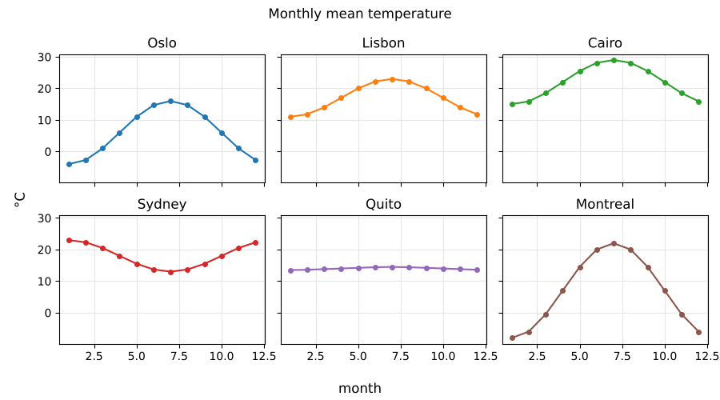

### Histograms and error bars

Histograms and error bars follow `Axes.hist` and `Axes.errorbar` down to numpy: `bins` takes a count, explicit edges,
or any `np.histogram_bin_edges` estimator (`'auto'`, `'fd'`, `'doane'`, …), and the counts and edges are numpy's,
bit for bit. `hist` returns a typed `[n, bins, patches]`, with one row per dataset when you pass several:

```ts
const [n, bins] = ax.hist([before, after], { bins: 'auto', histtype: 'stepfilled', alpha: 0.5, label: ['before', 'after'] });
ax.axvline(130.5, { color: 'C0', linestyle: '--' });
ax2.errorbar(days, p50, { yerr: [below, above], fmt: 'o-', capsize: 4 });   // asymmetric errors
```

[`examples/histogram_errorbar.ts`](../examples/histogram_errorbar.ts) (illustrative data) is also an oracle case (`fixtures/ref/example_histogram_errorbar`):

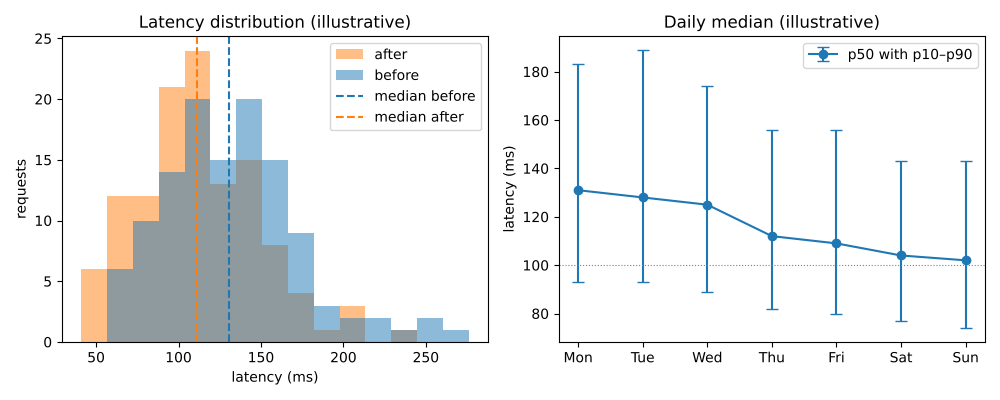

### Value-coloured scatter and equal aspect

`scatter` takes a numeric `c` with `cmap` / `vmin` / `vmax` (matplotlib's ScalarMappable path). Viridis is
built into the main entry; other colormaps (plasma, inferno, magma, cividis, twilight, turbo, coolwarm, RdBu,
Greys, Blues, tab10, tab20, and each `_r`) are separate modules you register, like fonts. An unregistered
name throws `ColormapNotLoadedError`. `set_aspect('equal' | number)` shrinks the Axes box (adjustable=`'box'`).

```ts
import { registerColormaps, subplots } from 'mpl';
import { plasma } from 'mpl/colormaps/plasma';

registerColormaps(plasma);
const [fig, ax] = subplots();
ax.scatter(x, y, { c: values, cmap: 'plasma', s: 40 });
ax.set_aspect('equal');
```

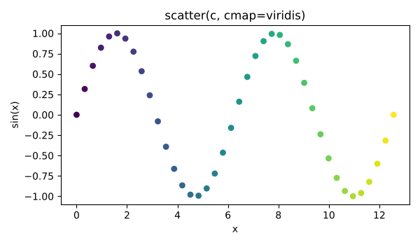

## API overview

```ts
import { subplots } from './src/index.ts';

const [fig, ax] = subplots({ style: 'ggplot' });          // any bundled .mplstyle, or your own
ax.plot(x, y, 'o--', { label: 'observed', color: 'C1' });
ax.bar(['apples', 'bananas', 'cherries'], [23, 17, 35], { label: 'count' });
ax.grid(true, { axis: 'y', color: '0.85', ls: '--' }); ax.legend(); ax.set_title('familiar');
fig.tight_layout();     // fit labels and titles inside the figure, as matplotlib does
fig.toSVG();            // string
fig.svgStream();        // ReadableStream<Uint8Array>, e.g. a Response body in a Worker
fig.toScene();          // the renderer-independent Scene tree (JSON-able)
fig.toPNGSync();        // Uint8Array, rasterized by mpl's own port of Agg
fig.toPNGSync({ dpi: 200 });              // matplotlib savefig dpi (default: figure dpi); pHYs matches Agg
fig.toPNGSync({ scale: 2 });              // convenience: dpi = figure.dpi × scale (retina = scale 2)
fig.toPNGSync({ colors: 64 });            // palette PNG: at most 64 colors, about a third of the RGBA file
fig.toPNGSync({ colors: 64, level: 9 });  // and the built-in deflate's slowest, smallest setting
```

The API is matplotlib-shaped (`subplots`, `plot`, `step`, `bar`/`barh`, `hist`, `errorbar`, `boxplot`, `fill_between`,
`axhline`/`axvline`/`axline`, `hlines`/`vlines`, `text`, `annotate`, `legend`, `grid`, `set_xlim`, `set_yscale('log')`,
`twinx`, `tight_layout`, styled tick labels, date axes, 9+ bundled styles); unknown keyword arguments are errors, as in
matplotlib. Subplot grids: `subplots(nrows, ncols, …)` with sharex/sharey, width/height ratios, `subplots_adjust` and
grid `tight_layout`.

Done and covered by the oracle: `plot` (incl. `drawstyle`), `step`, `scatter`, `bar`/`barh`, `hist` (every `histtype`,
stacked or side by side, horizontal, log, density, weights, cumulative, numpy's bin estimators), `errorbar`
(symmetric/asymmetric, caps, limits, `errorevery`), `boxplot`, `axhline`/`axvline`/`axline`, `hlines`/`vlines`,
`fill_between`, `text`/`annotate`, `legend`, `grid` with Line2D kwargs (major/minor), `tight_layout`, per-tick label
styling, multi-line text, log scales, date axes, `twinx`, 9+ bundled styles, PNG output (own Agg port), SVG with glyph
outlines (matplotlib's `svg.fonttype='path'`) or `<text>`.

Out of scope so far: `violinplot`, `pie`, `stem`, `stairs`, `fill`/`fill_betweenx`, spanning subplots (`subplot_mosaic`,
gridspec slices), general mathtext (only the tick-label forms `10^{n}` / `2×10^{n}`), constrained layout. Within the
plotting calls: hist's `hatch` and per-dataset `linestyle`, `axline` with a `transform`, and errorbar on polar axes or
with timedelta errors on date axes.

Two options are mpljs's own, not matplotlib's: `plot(…, { decimate })` keeps each device-pixel column's first, last,
lowest and highest samples (and both ends of every step) before path cleanup, for dense time series; and
`toSVG({ precision })` rounds path data to 0–4 decimals for smaller SVGs. Both are off by default, so default output
stays matplotlib's. Details in [api.md](api.md).

For SVG that renders the same whatever fonts the viewer has (GitHub, email), set matplotlib's
`svg.fonttype: 'path'` to write glyph outlines instead of `<text>`; see
[guides/annotated-charts.md](guides/annotated-charts.md).

## PNG output: palette and compression

`colors` (1–256, also on `toPNG` and `pngStream`) writes an indexed PNG. A figure with that few colors is encoded
exactly; otherwise the palette is chosen deterministically (weighted k-means over the figure's colors, with every color
covering ≥ 0.05% of the pixels kept exact), so only antialiased edges move. On the quickstart figure (640×480):
42,336 B as RGBA, 13,178 B at 64 colors (11,970 B with `level: 9`), PSNR 54.4 dB. `level` (1–9, as zlib's; sync only)
trades time for size as zlib's does (on the fixtures, level 9 is 8–10% smaller than the default at 5–12× the time,
within about 1% of zlib -9); left out, the default chart-tuned encoder runs. The encode is synchronous and its cost
grows with the level's match-chain length, so level 9 can take many seconds on a large, noisy canvas (8 MB of 2-bit
noise: 41 s at 9, 4 s at 6; a 3840×2880 chart: 1.7 s at 9).

## Colormaps and images

`imshow`, value-coloured `scatter`, and `colorbar` are supported with matplotlib's colormaps
(viridis, plasma, inferno, magma, cividis, twilight, turbo, coolwarm, RdBu, Greys, Blues, tab10, tab20, and `_r` reversed variants). The main entry includes viridis; other colormaps load through `mpl/colormaps/*` like the font split. For Workers, see [Lean loading](#lean-loading-workers).

```ts
import { subplots } from 'mpl';
const [fig, ax] = subplots();
const im = ax.imshow([[0,1,2],[3,4,5],[6,7,8]], { cmap: 'viridis' });
fig.colorbar(im, { label: 'value' });
```

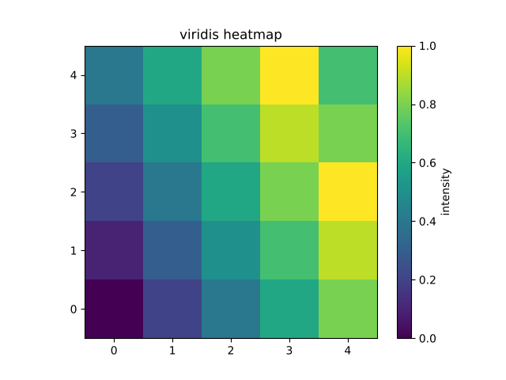

When `imshow` downsamples with hanning/bilinear (matplotlib's rgba-stage), it needs the colormap's exact float32 LUT. Viridis ships that LUT on the main entry; for other colormaps register the `.rgba` sidecar alongside the base pack, or rendering throws `MissingColormapRgbaError` instead of silently approximating:

```ts
import { registerColormapRgba, registerColormaps, subplots } from 'mpl';
import { plasma } from 'mpl/colormaps/plasma';
import { plasma_rgba } from 'mpl/colormaps/plasma.rgba';

registerColormaps(plasma);
registerColormapRgba(plasma_rgba);  // also accept plasma_r_rgba; skipped if plasma_r is not registered
```

Nearest interpolation and data-stage resampling use only the trunc/round LUTs and do not need the `.rgba` module.

`set_aspect('equal' | 'auto' | number)` shrinks the Axes box (adjustable='box'). Scatter accepts `zorder` and a numeric `c` with `cmap`/`norm`/`vmin`/`vmax`.

## Themes

Four dashboard-style sheets ship with mpl, next to matplotlib's own. They are plain `.mplstyle` files
([`styles/`](../styles/)), so matplotlib renders them too (`plt.style.use("styles/pro-dark.mplstyle")`), and every
figure below is pixel-exact against that render (`fixtures/ref/theme_*`, 21 cases).

| style | look |
|---|---|
| `pro-dark` | deep navy dashboard: faint grid, muted ticks, vivid but restrained accents |
| `pro-mono` | crisp black on white: hairline grid, grayscale with one blue accent |
| `pro-ember` | warm charcoal with an orange accent |
| `pro-slate` | soft off-white with muted indigo and violet accents |

All four use Inter, left-aligned titles, a y-only grid, no top/left/right spines and a frameless legend.

```ts
import { registerFonts, subplots } from 'mpl';
import { interRegular } from 'mpl/fonts/inter-regular';

registerFonts(interRegular);                       // the sheets set font.family: Inter
const [fig, ax] = subplots({ style: 'pro-dark' });  // or ['pro-slate', { 'lines.linewidth': 2 }]
```

[`examples/themes/dashboard.ts`](../examples/themes/dashboard.ts) draws the same service dashboard in each:

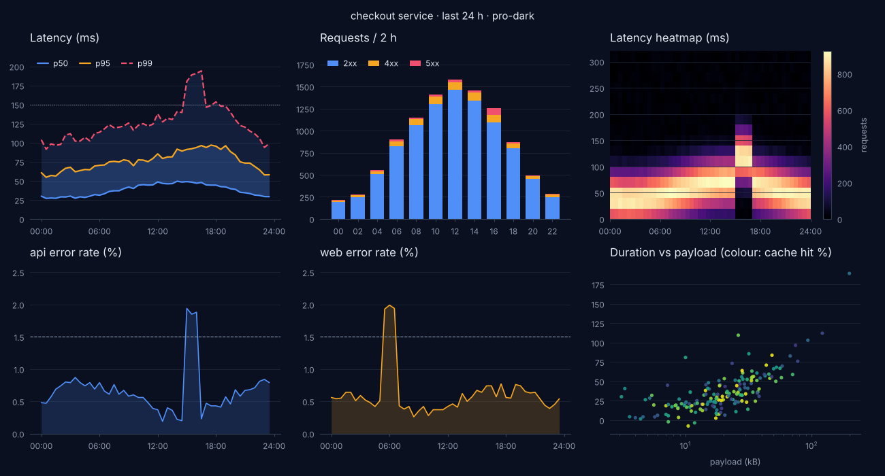
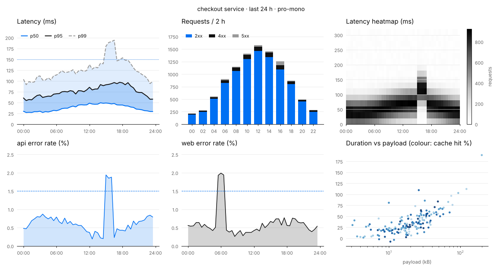
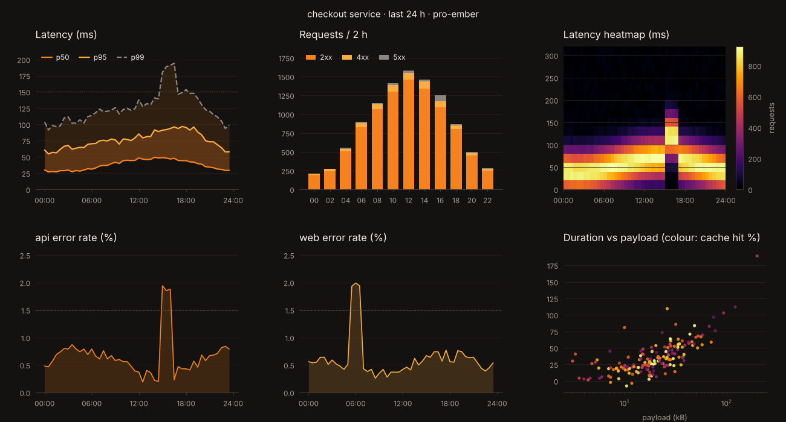
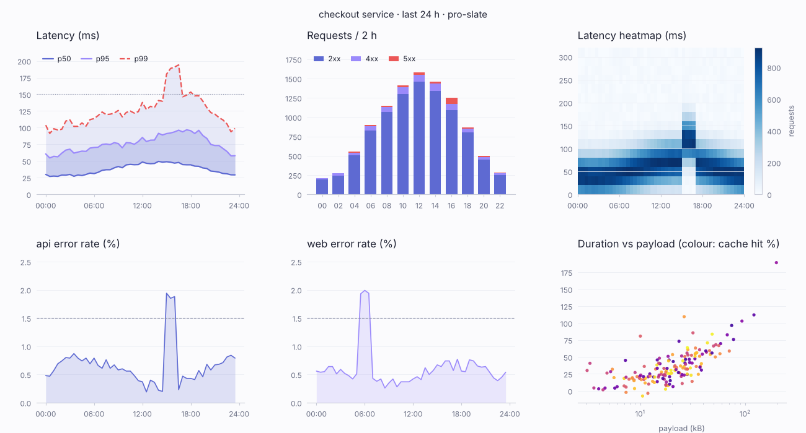

## Style sheets and rc

Layers, each a partial rc, later wins:

```
DEFAULTS  <  style sheet(s)  <  per-figure rc overrides  <  per-artist kwargs
```

A style is a bundled matplotlib name (`'ggplot'`, `'dark_background'`, `'fivethirtyeight'`, `'seaborn-v0_8-darkgrid'`, …) or one of the [pro themes](#themes),
raw `.mplstyle` text, or an rc object. They compose: `subplots({ style: ['seaborn-v0_8-whitegrid', { 'lines.linewidth': 3 }] })`.
Because the keys and the parser are matplotlib's, the bundled styles are *verified against matplotlib's rendering of the same style*
(18 fixtures). Two matplotlib behaviours this exposed: lines and filled patches have **independent** color cycles
(a bar chart's trend line is C0, not C1), and the oracle is `savefig` output, so `savefig.facecolor` wins over `figure.facecolor`.

## Interactive SVG (annotated)

The server renders; the browser only reads. `fig.toSVG({ interactive: true })` draws exactly the same SVG (default
output is byte-identical with the option off), wraps each Axes in `<g data-mpl-axes="k">` and puts a small JSON
sidecar first in it, inside an inert `<metadata class="mpl-axes">`: the axes box in SVG user units, each axis' scale
(`linear`, `log` + base, `date` as matplotlib date numbers, `cat` + names), view limits and inversion, and per artist
its kind, label, colour, data points and matching pixel points, plus each legend entry's box. Every artist's group
already carries `data-artist="artist/<i>/<kind>"`, which indexes the sidecar's `a[i]`. The schema is documented at the top of
[`src/render/annotate.ts`](../src/render/annotate.ts).

```ts
// server (Node, a Worker, …): the writer is opt-in, so bundles that never annotate leave it out
import { registerSidecar } from 'mpl';
import { sidecar } from 'mpl/annotate';
registerSidecar(sidecar);
const svg = fig.toSVG({ interactive: true, idPrefix: 'c1-' });   // idPrefix: several SVGs in one page
// browser: 17.9 KiB minified, 7.4 KiB gzipped, no dependencies
import { attach } from 'mpl/interactive';
const detach = attach(document);              // every annotated SVG under the root
```

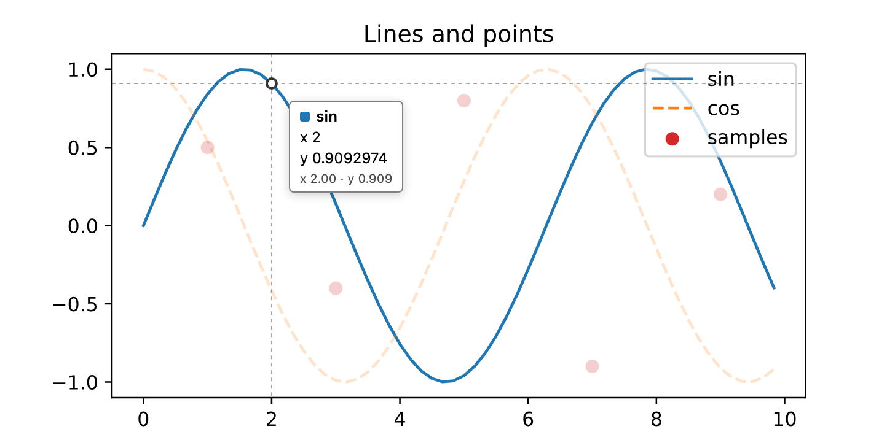

`attach` adds a crosshair and a tooltip for the nearest point (line, step and bar series snap along their axis, steps
to the step holding the value). Where an Axes has such a series the tooltip and crosshair follow it, snapped to the same
point; a scatter marker or an unordered line's point takes over only with the pointer on it (the marker's radius plus a
few pixels), and in an Axes of only those, the nearest one in 2D is reported. The tooltip reads as a sentence, not a
coordinate pair: the series name and its value, with the unit when the axis label gives one (`ms`, `latency (ms)`,
`Latency [ms]` → `72.4 ms`, or the title's when there is no axis label; an artist with no label is named, muted, by the
value axis' label or else the Axes title; a rate label like `requests / s` is shown muted beside the value), and under it, muted, the
position on the other axis. Dates print at the resolution the series has: `Nov 5, 08:40` for minutely data, `Nov 5` for
daily, with no year unless the axis crosses one; numbers to the axis' per-pixel resolution (at least 3 significant
digits, log axes 3). A stacked bar shows its own height with the stack total muted (`client: timed out 37`, `50 total`).
With no point to report the crosshair stands alone. Other series in the hovered Axes (and its twin) dim gently while one
is hovered; other Axes are untouched. A legend entry is a toggle (click, or Tab + Enter/Space). A focused plot steps
through points with the arrow keys (Up/Down change series, Escape hides). Pointer positions map through `getScreenCTM`,
so the SVG can be scaled freely (drop `width`/`height`, keep `viewBox`).

On touch a tapped value stays after the finger lifts, until the next tap, a tap outside the axes, or Escape, and it
follows its point through a scroll. Under `mpl/zoom`, where a finger pans, the value shows on lift when the finger did
not travel. The tooltip is kept inside the visible part of the chart (the chart's box cut by the viewport and any
clipping ancestor), not the viewport: beside a mouse, centred above a finger (below it when there is no room).

The second argument of `attach` is a value formatter or an options object:

```ts
attach(document, (v, axis, which, exact) => …);   // a formatter (fall back to the exported formatValue); its text is used as is, no unit added
attach(document, {
  format,                // the same, as an option
  compact: 480,          // below this visible chart width (CSS px) the tooltip is compact; 0 never, Infinity always
  gap: 14,               // CSS px from a mouse or focus position
  touchGap: 32,          // CSS px from a finger
  margin: 4,             // CSS px kept from the chart's edges
  placement: 'auto',     // 'auto': beside a mouse, above a finger; 'above': above and centred for every pointer
  cursor: false,         // true also lists the cursor's own data coordinates under the point
});
```

Panels that show the same x read together: hovering one draws the vertical crosshair at that x in the others, with a
dot on each series at its nearest point (a finger's value does the same, and persists with it). The tooltip and the
horizontal line stay on the hovered panel. Two Axes sync when they share an x axis (`sharex`, `twinx`), or when all of
these hold: the same kind of x scale, never categories; x-limits at least 80% the same (intersection over union, at
first paint, so zooming does not change who syncs); and both hold data along x (a series with points on a date axis; on
linear and log axes a series ordered along x, so scatter plots and horizontal bars stay apart). On a dashboard of
latency, throughput and CPU over one day plus a histogram of milliseconds and bars by endpoint, the first group syncs
and the other two do not. `sync` chooses the scope: `true` (default) within each figure, a name links every figure
attached with it (`attach(root, { sync: 'ops' })`, `idPrefix` or not), `false` turns it off. Moving the crosshair
re-renders nothing.

Theming is CSS only: `--mpl-dim-opacity`, `--mpl-crosshair`, `--mpl-crosshair-opacity`, `--mpl-dot`, `--mpl-dot-fill`,
`--mpl-legend-off`, `--mpl-legend-off-opacity`, `--mpl-focus`, `--mpl-tip-font`, `--mpl-tip-bg`, `--mpl-tip-fg`,
`--mpl-tip-border`, `--mpl-tip-radius`, `--mpl-tip-padding`, `--mpl-tip-shadow`, `--mpl-tip-small-size`, `--mpl-tip-max-width`,
`--mpl-tip-compact-size`, `--mpl-tip-compact-padding`, and the classes `.mpl-tip`, `.mpl-tip-compact`, `.mpl-dim`, `.mpl-off`, `.mpl-cross`, `.mpl-dot`,
`.mpl-lg`. Defaults follow the page's `color-scheme` (`Canvas`/`CanvasText`), and the dimming transition is off
under `prefers-reduced-motion`. [`examples/interactive.ts`](../examples/interactive.ts) writes a page with four charts
(lines + scatter, steps on a date axis, log bars with a twin axis, categories and an inverted axis);
`npm run test:interactive` drives it in headless Chromium.

Limits: an artist keeps at most 2,000 points in the sidecar (ordered series keep each bucket's min and max, scatter
every k-th point), and points outside the axes box are left out. Only line, step, bar/barh, hist bars and scatter
carry points; fills, spans, reference lines (`axhline`/`axvline`/`axline`), segments, polygons, images and text are
listed (kind, label, colour) so they can be highlighted and toggled, but are not hit-tested. Colorbars are Axes like
any other and get a sidecar, but no readout of the colormap value. The client never re-renders; for zoom and pan see
[`mpl/zoom`](#zoom-and-pan-mplzoom), which re-renders and tells this client to re-read the new sidecars. With
`toSVG({ precision, interactive: true })` the sidecar's pixel points round like the path data (exactly on the drawn
line vertices at precision 0–2, within 0.005 px above); markers sit at their exact positions, as matplotlib's SVG
backend writes them.

A tooltip never prints a coordinate the axis does not show. On an axis with fixed tick labels (`set_xticks` + `set_xticklabels`), a point exactly on a tick reads as that tick's label, and a point between ticks has no x line at all; a label is never interpolated or guessed. Numeric and date axes keep their values.

## Zoom and pan (mpl/zoom)

Every frame is a real mpljs render. The page keeps its server-rendered annotated SVG as the first paint (no JS needed,
nothing changes). The first gesture lazily loads a figure factory that the page supplies, because mpljs cannot rebuild a
figure from SVG. From then on each frame calls `set_xlim`/`set_ylim` on that live Figure, then `toSVG({ interactive: true })`.
Dense charts instead get `toRGBA()` on a canvas while the gesture runs, then one SVG frame when it settles. After each
SVG frame, `mpl/interactive` re-reads the new sidecars, so tooltips, the crosshair and legend toggles work on the
zoomed view; legend toggles and keyboard focus carry over.

Panels synced for the crosshair zoom together too: a zoom or pan of x in one applies the same x-limits to the others, in
the one figure render of that frame, and reset resets all of them. y stays each panel's own: only the panel under the
gesture zooms y, and the others keep the limits they had (nothing re-autoscales, as for any zoom). `zoom(svg, { sync })`
takes the same `true` / name / `false`; with a name, each figure renders its own frame.

```ts
import { attach } from 'mpl/interactive';
import { zoom } from 'mpl/zoom';           // with mpl/interactive: 21.7 KiB min, 8.6 KiB gzip; mpljs loads on demand
attach(document);
const ctl = zoom(document.getElementById('c1'), {
  idPrefix: 'c1-',                         // as the server passed to toSVG
  load: async () => (await import('./chart.js')).build(),   // the same figure the server drew (registerSidecar there too)
});
ctl.view();                                // [{ x: [lo, hi], y: [lo, hi], set: { x, y } }] per Axes
```

- **Gestures.**
  - Wheel or trackpad pinch zooms about the pointer, and a sideways scroll pans x.
  - Drag pans. Shift+drag zooms to a box; as in matplotlib's zoom tool, a box under 5 px on one side zooms only the other axis.
  - Over an axis' tick strip, just outside the plot box, only that axis moves.
  - Double-click or Escape resets. Reset restores the server's first-paint DOM and the figure's original limits.
  - Touch: two fingers pinch and pan. One finger pans horizontally while the page keeps vertical scrolling
    (`touchAction: 'pan-y'`; pass `'none'` to give the chart every touch).
  - Keyboard, on a focused chart: `+`/`-` zoom, the arrow keys pan (Shift+arrows on a plot the hover client focused,
    where plain arrows step through points), `0`/Escape reset.
- **Scales.** Log axes zoom in log space. Date and category axes are linear in their numbers.
- **Linked axes.** Axes that share an axis (`sharex`/`sharey`, `twinx`) move together. The sidecar now carries each
  axis' share group `g`. A colorbar's Axes (`cb`) never zooms.
- **Scheduling.** Input only updates the wanted view. One `requestAnimationFrame` renders the latest one, so there is at
  most one render per frame, and a frame that overruns drops the states in between.
- **Renderer.** `renderer: 'auto'` (the default) renders SVG frames.
  - It switches gesture frames to canvas when the chart has more than `threshold` SVG elements (default 1200), or once
    an SVG frame takes longer than `budgetMs` (default 12 ms).
  - The canvas is drawn at an integer scale of about devicePixelRatio × its CSS size, from 1× to 3×, so text stays crisp.
  - The settled frame is always SVG.
  - The threshold comes from the measurements below: SVG frame cost is dominated by the browser's DOM work and grows
    with element count, while canvas cost depends mostly on pixel count.
- **Other options.**
  - `wheel: 'always' | 'modifier' | 'off'`: `'modifier'` zooms only with Ctrl/⌘ or pinch, so the page scrolls.
  - `preload: 'hover'` loads on pointer-enter instead of the first gesture.
  - `svgText(s)` applies the same rewrite to each frame that the page applied to its server SVG, such as theme colour
    variables.
  - `onFrame(info)` reports each frame: kind, scale, render and DOM ms, the SVG text, and the view.
  - The controller has `view()`, `setView(k, x, y)`, `reset()`, `idle()`, `last()` and `destroy()`.

`View.set` says which limits zoom has set on the figure. The same Figure with those `set_xlim`/`set_ylim` calls renders the
same frame in Node. `npm run test:zoom` proves that frame by frame. It drives
[`examples/zoom.ts`](../examples/zoom.ts)'s page in headless Chromium with real wheel, drag, Shift+drag, double-click,
keys and two-finger touch. Every SVG frame must equal Node's `toSVG` text for its view, and the DOM must equal parsing it.
Every canvas frame must hold Node's `toRGBA` bytes at its scale.

Measured in headless Chrome (Playwright's chromium-headless-shell) on an M3 Max, bench run `zoom-2026-11-08d` (this change
on 5def436, so scatter SVG uses `<defs>` + `<use>` and canvas frames reuse the previous raster through `toRGBA({ out })`),
scripted zoom + pan, 119 warm frames per load, 3 loads. Times are ms per frame (mpl render + DOM update; paint not included),
p50 / p99, the median over loads. The last column counts animation-frame intervals over 17.5 ms, out of about 120:

| chart | SVG elements | SVG frame | canvas 1× | canvas 2× (DPR 2) | long rAF intervals, SVG |
|---|---|---|---|---|---|
| lines, log y, dates, sharex + twinx (the demo) | 172–265 | 1.5–2.2 / 2.2–4.1 | 1.7–2.2 / 2.3–4.0 | 3.1–4.6 / 4.1–6.4 | 0 |
| scatter, 250 points | 694 | 3.6 / 10.2 | 2.3 / 5.4 | 3.7 / 6.1 | 3–8 |
| scatter, 500 points | 944 | 4.6 / 11.0 | 3.1 / 3.8 | 5.2 / 5.9 | 0–1 |
| scatter, 1,000 points | 1,428 | 6.7 / 20.3 | 4.8 / 5.4 | 7.8 / 9.3 | 2–44 |
| scatter, 2,000 points + colorbar | 2,430 | 12.1 / 26.3 | 9.1 / 12.1 | 14.2 / 17.4 | 1–6 (demo), 63–75 (sweep) |
| scatter, 4,000 points | 4,439 | 18.4 / 78.6 | 15.2 / 16.3 | 24.9 / 26.6 | 121–126 |

mpl's SVG render is cheap: 2.8 ms for 2,000 markers as `<use>`. The cost is the browser's, in the DOM update and then in
style and paint, which shows up in the p99 and in long animation frames rather than in the p50. Canvas frames cost by
pixels, plus about 3 µs per marker, and stay smooth. From about 1,400 elements, SVG frames stutter: scatter-1000 ran long
in up to 44 of 120 intervals, while scatter-500 stayed smooth. So the default `threshold` is 1,200 elements, and canvas
is used above it.

The first frame after the first gesture took 31–37 ms on a light chart: chunk import, the figure build, first-use font
decode and the render. The first chart on the page took 70–85 ms, because that one also parses and evaluates the lazy
chunk (about 0.5 MB). No run drew two frames of a chart in one animation frame.

## Tracing

```js
import { tracer } from './src/index.ts';
tracer.enable();                       // otherwise every span is a shared no-op
fig.toSVG();                           // one trace per run: figure.layout → axes.layout → {autoscale,ticks,artists,axis.draw,legend} ; render.svg
await tracer.flush('spans.jsonl');     // OTLP/JSON Span per line; tracer.toOTLP() for an ExportTraceServiceRequest
```

Spans are deliberately dense — per artist, per tick, per text layout, per legend candidate, per rendered node — so n+1 and
multi-pass patterns show up as repeated children. `bench/trace_tree.ts` prints the tree with attributes; `bench/bench.ts`
reports warm p50/p95 per span. Enabled, tracing costs ~13% on a 115-span render; disabled, every span is a shared no-op
that never reads the clock.

## Runtimes and bundle size

Each runtime below renders the same 9 fixtures (both font families, log axes, a style sheet, grids,
hist, errorbar, dates, annotate) with the published `dist/browser` build. CI checks that `toSVG()` and
`toPNGSync()` are byte-identical to Node and that every PNG matches matplotlib's Agg pixel for pixel.

| Runtime | How it is tested | Command |
|---|---|---|
| Node 24 | the full oracle suite | `npm test` |
| Chromium (headless, via Playwright), in a non-UTC time zone and a non-English locale | unbundled ES modules loaded by the page | `npm run test:browser` (`CHROMIUM_PATH=…` for a Chromium other than Playwright's) |
| Cloudflare Workers (workerd, local) | a small Worker in `test/workers`, run with `cf dev` and also from its `cf build` output | `npm run test:workers` |

Nothing else (Firefox, Safari, Deno, Bun, deployed Workers) is tested yet.

Bundle size: esbuild minified + gzip -9, printed by `npm run size` and checked against
[`size-budget.json`](../size-budget.json) (+2%) by `npm run test:size`. At the time of writing:

| scenario | minified | gzipped |
|---|---|---|
| `mpl/core`, no faces or colormaps (code + tables only) | 342 KiB | 116 KiB |
| default entry: `subplots`, `plot`, `toSVG`, `toPNGSync` (DejaVu Sans + viridis built in) | 505 KiB | 179 KiB |
| `mpl/core` + Inter ×4 + magma + viridis (+ rgba) | 684 KiB | 194 KiB |
| everything (every export and all 8 faces) | 1228 KiB | 387 KiB |
| `mpl/interactive`, the annotated-SVG client alone | 9.7 KiB | 4.2 KiB |
| `mpl/zoom` + `mpl/interactive` (what a zoomable page ships before mpljs loads) | 21.7 KiB | 8.6 KiB |

Each further face adds 16–17 KiB gzipped (an Inter weight) or 43–55 KiB (a DejaVu face), measured as a
standalone minified module. Glyph data is packed losslessly (delta-coded integers as base64 VLQ), 36% smaller
gzipped than the JSON tables it replaced.
