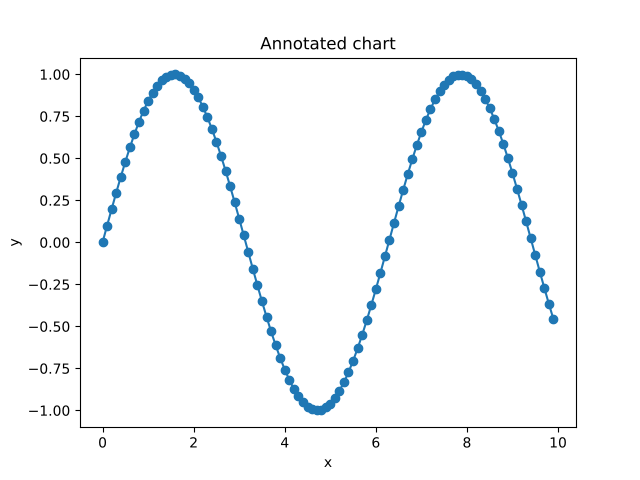
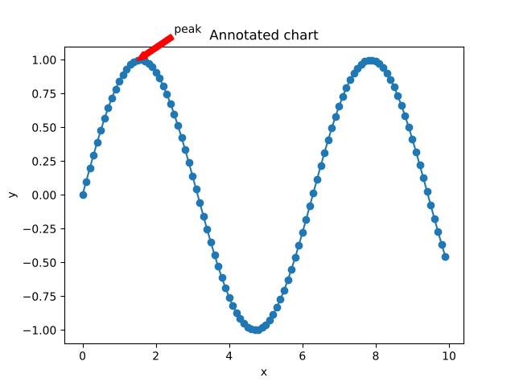

### Annotated charts (SVG paths)

This example shows adding annotations and emitting SVG with glyph outlines (`rc: { 'svg.fonttype': 'path' }`), so the text always renders the same across viewers.

Before annotation:



After annotation:



Code:

```ts
import { subplots } from 'mpljs';
const [fig, ax] = subplots({ rc: { 'svg.fonttype': 'path' } });
const x = Array.from({ length: 100 }, (_, i) => i / 10);
ax.plot(x, x.map(Math.sin), 'o-', { label: 'sin(x)' });
ax.annotate('peak', [1.5, Math.sin(1.5)], { xytext: [2.5, 1.2], arrowprops: { color: 'red', linewidth: 2, headlength: 8, headwidth: 6 } });
const svg = fig.toSVG();
```

