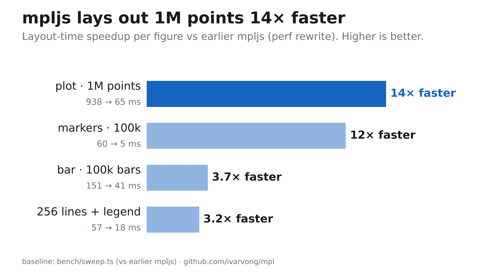
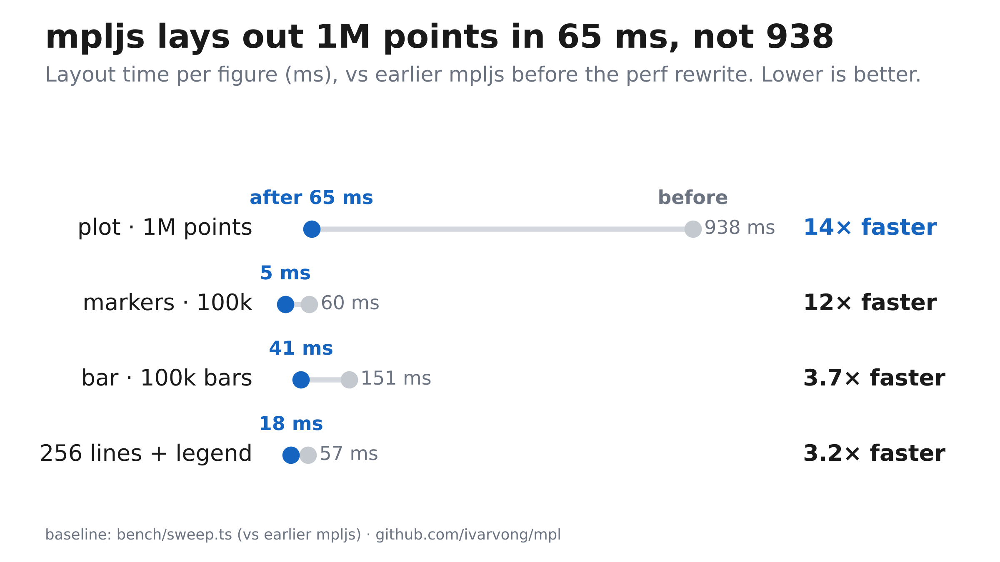
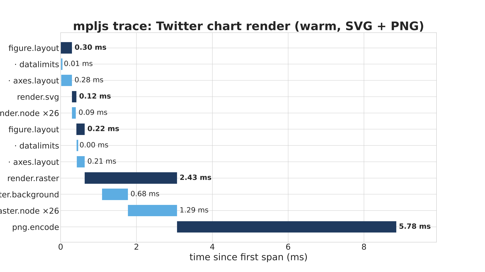
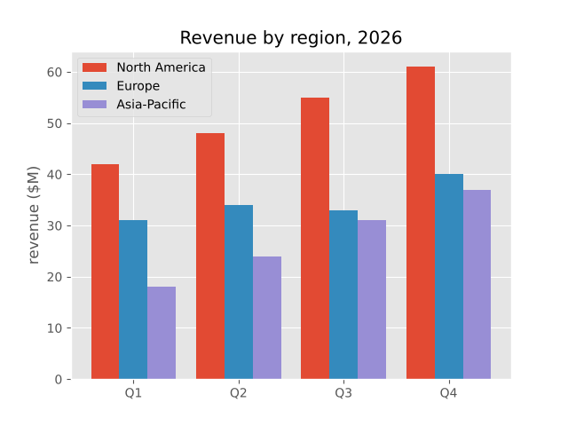
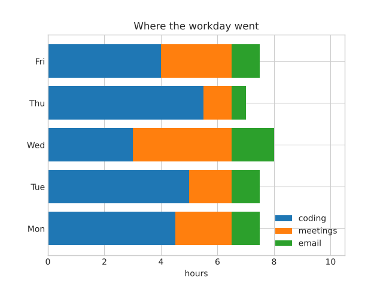
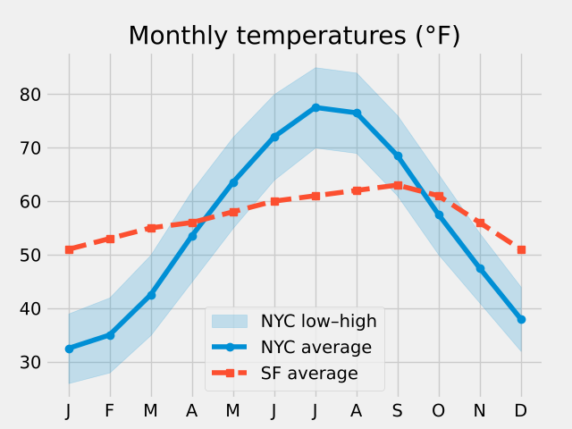
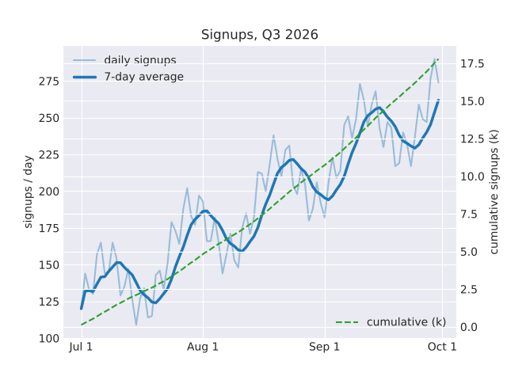

## Pro charts with mpljs (how‑to)

Images first; each is rendered by a tiny example under `examples/` and committed here under `docs/images/`. Every speed claim names its baseline — “vs mpljs before the perf rewrite (bench/sweep.ts)”.

### Twitter‑ready hero (speedup bars)



Render it yourself:
```bash
node examples/twitter_pro.ts
```

### Dumbbell (before → after, ms)



```bash
node examples/twitter_pro.ts
```

### Trace the render and see where time goes



```bash
node examples/trace_render.ts
```

### Four starter charts

<p>
  
  
  
  
</p>

```bash
node examples/starter_charts.ts
```

### How to make charts like this

Size for X/Twitter and use rc overrides for phone‑legible type and minimal ink:
```ts
const [fig, ax] = subplots({
  figsize: [16, 9], dpi: 150,
  rc: {
    'font.size': 24,
    'axes.spines.left': false, 'axes.spines.right': false,
    'axes.spines.top': false,  'axes.spines.bottom': false,
    'axes.grid': false, 'xtick.bottom': false, 'xtick.labelbottom': false,
    'ytick.left': false, 'ytick.labelleft': false,
    'figure.subplot.left': 0.30, 'figure.subplot.right': 0.86,
    'figure.subplot.bottom': 0.11, 'figure.subplot.top': 0.75,
  },
});
```
There is no figure‑level text yet; place headline/subtitle/footer using `ax.text` in axes coords mapped from figure coords.

```ts
const fx = (x: number) => (x - L) / (R - L), fy = (y: number) => (y - B) / (T - B);
ax.text(fx(0.045), fy(0.915), 'Bold headline', { transform: ax.transAxes, fontsize: 38, fontweight: 'bold' });
```
Use `plot('o')` for dots (no `scatter` yet). Prefer direct labels over a legend for single‑figure images.

### How this was made (with Grok Bot)

Wrote four starters, a 2400×1350 “Twitter” chart, traced a warm render, then refined layout/labels. Iteration fixes spotted in images:
- Fixed date ticks to avoid overlap.
- Moved legend and widened the axis when it covered a bar.
- Increased font sizes for phone readability.
- Raised the y range when a label intersected the legend.
- In the dumbbell, started x at −30 so a 5 ms dot isn’t clipped.
- Nudged the right‑side ratio column to avoid a collision.
- Increased right margin after a clipped edge.
- Reworked the takeaway to always name the baseline (“vs mpljs before the perf rewrite”, from `bench/sweep.ts`).

### API gaps

- No figure‑level text (`fig.text`/`suptitle`) — use `ax.text` in axes coords.
- No spine/tick mutators — use rc (`axes.spines.*`, `xtick.*`, `ytick.*`).
- No `subplots_adjust` — use `figure.subplot.*` rc keys.
- No two‑line tick labels.
- No `scatter`; use `plot('o')`.
- Markers clip at the axes edge.
- Tracer: `tracer.flush()` exists (OTLP JSON lines). Layout is recomputed per output format.

